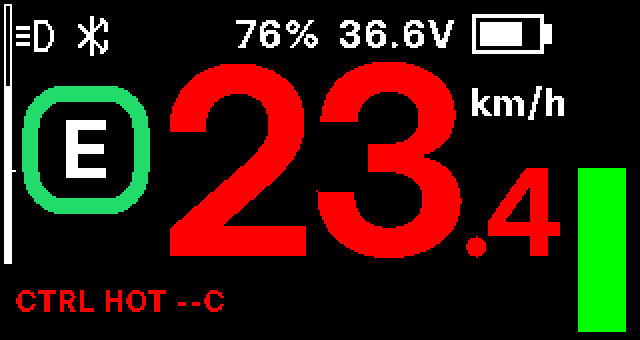

# EVistDrive HMI

Independent, GPL-3.0-or-later firmware for the Bafang DPC245 V3 bicycle display. The application runs on a GD32F303 family MCU and communicates with the existing controller and radio over CAN and UART.

**User manuals:** [English](docs/USER_MANUAL_EN.md) · [Polski](docs/USER_MANUAL_PL.md)

**[Build from a fresh checkout](docs/BUILDING.md)** · [Architecture](docs/ARCHITECTURE.md) · [Hardware](docs/HARDWARE.md) · [Contributing](CONTRIBUTING.md)

## Features

- 320 × 170 dashboard with STANDARD, YELLOW, ARC and WEDGE themes, ten lower information panels, ride statistics, battery and power views.
- Assist selection, physical-key Walk control, RIDE MODE, temperature warnings, menus and configurable display lighting.
- CAN telemetry and service transport, controller settings with validation and read-back, BLE application transport and update entry.
- External SPI settings storage with a CRC-protected record ring and a host screen simulator.

## Screenshots

Rendered by the host simulator (`make screenshots`), 2× scale.

| | |
|---|---|
|  |  |
| **STANDARD** — speed, assist mode, battery, power bar and a switchable lower pair | **YELLOW** — the same layout with a yellow colour set |
|  |  |
| **ARC** — power arc, arrow speed frame, two switchable tiles (OFFROAD ring shown) | **WEDGE** — mode wedge, side panel tiles and a tapered power bar |
|  |  |
| **Overheat warning** — speed turns red when a user temperature limit is reached | **Main menu** |
|  |  |
| **THEMES** — choose, then SAVE | **TEMP VIEW** — motor and controller limits |
|  | |
| **ASSIST** — per-level settings with validation and read-back | |

## Hardware and status

The target is a Bafang DPC245 V3 display with a GD32F303 family MCU in LQFP100. The unit used for development reports 1024 KiB Flash. The application uses a 64 KiB SRAM window; 96 KiB for the leading GD32F303VGT6 candidate is inferred, not measured. The exact order-code suffix is unconfirmed. See the [hardware specification](docs/HARDWARE.md) for the memory map and interfaces.

The author uses this firmware regularly. New features are checked on a stand before road use. Verify display and controller settings on your own setup.

## Build and update

On Ubuntu or WSL2 with Clang, LLD, LLVM tools, GNU Make, Python 3 and Git:

```sh
make check
make sim
make update
```

`make check` builds and tests the firmware and the installation file. `make sim` creates `sim/out/index.html`. `make update` creates `build/EVistDrive_HMI_<version>_Update.bin`: a 32-byte header followed by the application. See [BUILDING.md](docs/BUILDING.md) for setup, inspection, checksums and flashing.

Installation uses the BESST update workflow; the display's own updater is never overwritten, and the application has update entry paths by key chord, BLE and CAN. Do not interrupt a transfer. Read the [build and release guide](docs/BUILD_AND_RELEASE.md) before installing an image.

## Repository layout

`include/` contains interfaces, `src/` the application, `platform/dpc245/` MCU drivers and startup, `sim/` the host display renderer, `tests/` host tests, `tools/` build utilities, and `docs/` technical specifications.

Contributions are welcome under the [contributing guide](CONTRIBUTING.md). The firmware is licensed under [GPL-3.0-or-later](LICENSE); bundled font licensing is in [NOTICE](NOTICE).

## Safety and legal

Use at your own risk. Confirm safe operation and local legal limits before riding. OFFROAD mode and the “Fake Taxi” assist profile are for use off public roads only where permitted by law. EVistDrive is not affiliated with Bafang. Bafang and other trademarks belong to their respective owners.

For interoperability with the controller, the radio module and service tools, the firmware answers identity queries with the standard DPC245 V3 identification strings (hardware, software and model identifiers, the manufacturer field and the radio name; see [CAN protocol](docs/CAN_PROTOCOL.md#identity-strings)). These strings are protocol values only; they do not imply origin, affiliation or endorsement.
