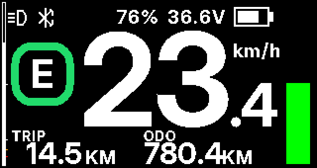
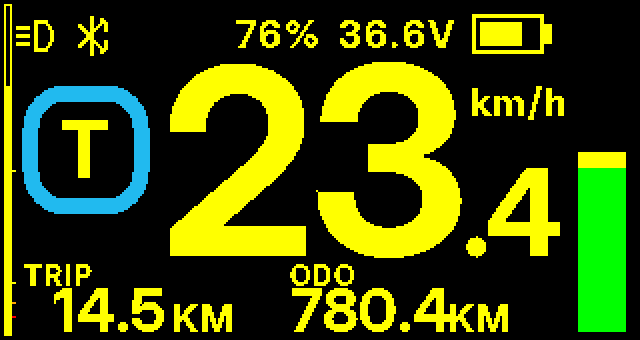
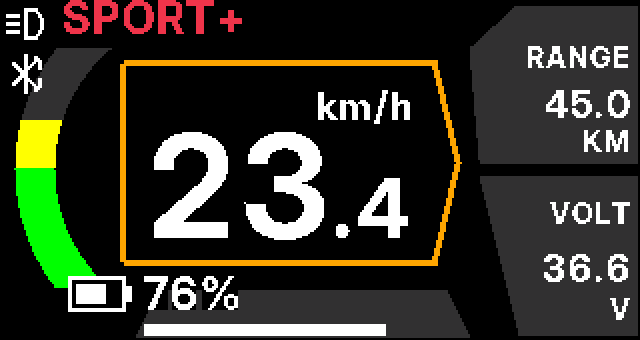
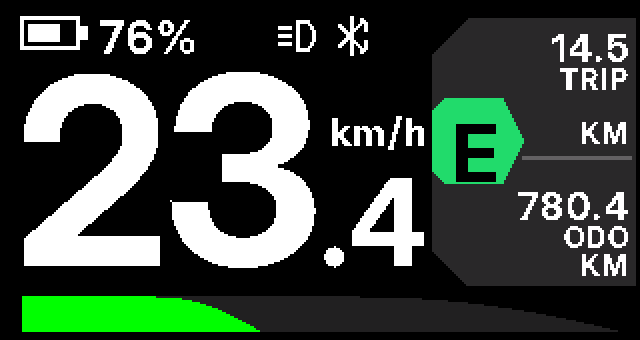
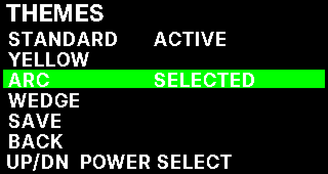
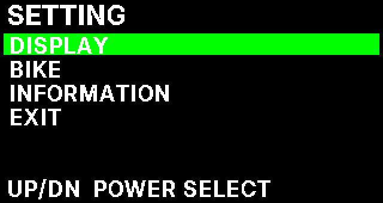
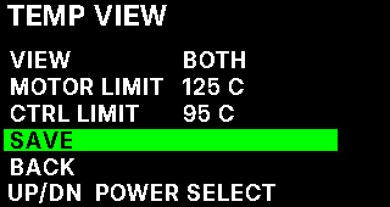
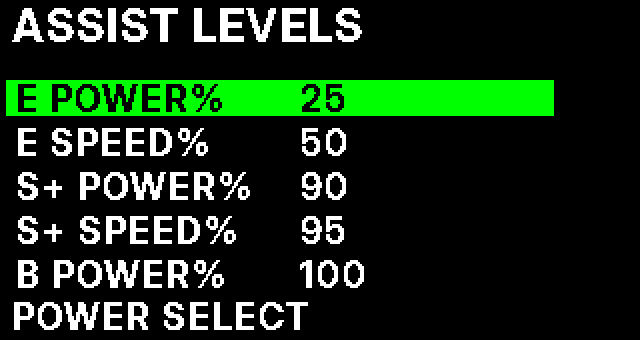
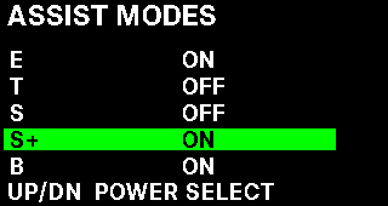

# EVistDrive HMI – Bafang DPC245 V3

## Instrukcja użytkownika i opis całego menu

**Wersja dokumentacji:** robocza 1.0, 15.10.2026

**Oprogramowanie odniesienia:** EVistDrive HMI **10.25**, wersja robocza do testu na urządzeniu.

**Język interfejsu:** angielski; w tej instrukcji zachowano dokładne nazwy opcji widoczne na ekranie.

**Przeznaczenie:** użytkownik roweru z wyświetlaczem Bafang DPC245 V3 i własnym firmware EVistDrive HMI.

> **Ważne:** Jest to instrukcja oparta na implementacji firmware i dokumentach projektu, wymagająca jeszcze końcowej weryfikacji przez opiekuna projektu. Nie zastępuje testu na fizycznym wyświetlaczu i zgodnym kontrolerze. Różne wersje kontrolera mogą inaczej obsługiwać część ustawień. Ustawienia `OFFROAD` wolno stosować wyłącznie w miejscu i w sposób dopuszczony przez obowiązujące przepisy.

## Spis treści

1. [Pierwsze kroki](#1-pierwsze-kroki)
2. [Przyciski i nawigacja](#2-przyciski-i-nawigacja)
3. [Ekran główny](#3-ekran-główny)
4. [Struktura całego menu](#4-struktura-całego-menu)
5. [DISPLAY – ustawienia wyświetlacza](#5-display--ustawienia-wyświetlacza)
6. [BIKE – ustawienia roweru i wspomagania](#6-bike--ustawienia-roweru-i-wspomagania)
7. [INFORMATION – dane i diagnostyka](#7-information--dane-i-diagnostyka)
8. [Zapisywanie ustawień](#8-zapisywanie-ustawień)
9. [Komunikaty i ostrzeżenia](#9-komunikaty-i-ostrzeżenia)
10. [Rozwiązywanie typowych problemów](#10-rozwiązywanie-typowych-problemów)
11. [Bezpieczeństwo i aktualizacja firmware](#11-bezpieczeństwo-i-aktualizacja-firmware)
12. [Słownik skrótów](#12-słownik-skrótów)
13. [Podstawa dokumentacji i weryfikacja](#13-podstawa-dokumentacji-i-weryfikacja)

---

## 1. Pierwsze kroki

Po uruchomieniu roweru wyświetlacz pokazuje ekran EVistDrive HMI. Najważniejszym wskazaniem jest prędkość. Poza nią można obserwować poziom wspomagania, stan baterii, bieżącą moc oraz dwa wybrane parametry jazdy.

**Szybka obsługa:**

1. Krótko naciśnij `UP (+)`, aby zwiększyć poziom wspomagania.
2. Krótko naciśnij `DOWN (-)`, aby zmniejszyć poziom wspomagania.
3. Krótko naciśnij `POWER`, aby przełączyć zestaw informacji na dole ekranu. Możesz wcześniej wskazać w menu, które zestawy mają być dostępne.
4. Przytrzymaj jednocześnie `UP` i `DOWN` przez około **0,5 s**, aby otworzyć menu ustawień.
5. Aby wyjść z ustawień, wybierz `EXIT` lub pozostaw menu bez obsługi przez około **30 s**. Niezapisane edycje w podmenu zaawansowanym zostaną porzucone. Trwająca operacja zapisu może jeszcze być wykonywana.



*Ekran STANDARD w symulatorze projektu. Wygląd rzeczywistego ekranu zależy od wybranego motywu, aktywnych pól i danych z kontrolera.*

## 2. Przyciski i nawigacja

Wyświetlacz ma trzy przyciski: `POWER`, `UP (+)` oraz `DOWN (-)`.

| Działanie | Na ekranie jazdy | W menu / podczas edycji |
|---|---|---|
| `UP` – krótko | Wyższy poziom wspomagania | Poprzedni wiersz albo zwiększenie wartości |
| `DOWN` – krótko | Niższy poziom wspomagania; na poziomie 0 obsługa standardowego Walk Assist | Następny wiersz albo zmniejszenie wartości |
| `POWER` – krótko | Następny aktywny zestaw dolnych pól | Wejście, wybór, rozpoczęcie/zakończenie edycji, zatwierdzenie na określonych ekranach |
| `UP + DOWN` razem przez ok. 0,5 s | Otwiera główne menu `SETTING` | Skrót przewidziano dla ekranu jazdy |
| `UP` – przytrzymanie ok. 4 s | Przełącza oświetlenie roweru | Nie służy do zmiany jasności LCD |
| `DOWN` – przytrzymanie | Walk Assist zgodnie z aktualnym poziomem i konfiguracją | W edytorach wartości ma zastosowanie powtarzanie zmian, nie Walk |

**Nawigacja po typowej stronie ustawień:** `UP/DOWN` wybiera wiersz → `POWER` włącza edycję → `UP/DOWN` zmienia wartość → `POWER` kończy edycję → przejdź na `SAVE` i naciśnij `POWER`. Wybranie `BACK` bez `SAVE` zwykle odrzuca zmiany. Niektóre proste ekrany (np. `UNIT`) działają od razu i nie mają osobnego `SAVE`.

Przytrzymanie `UP/DOWN` podczas edycji może przyspieszać przewijanie wartości: pierwsze powtórzenia po około 0,4 s, szybsze po około 2 s. Niektóre wartości zatrzymują się na końcach zakresu, zamiast wracać do początku.

**Uwaga o `POWER`:** długie przytrzymanie tego przycisku nie jest poleceniem programowego wyłączenia. Fizyczne załączanie i odłączanie zasilania obsługuje elektronika wyświetlacza/roweru.

### 2.1. Walk Assist – prowadzenie roweru

**Standard Walk na poziomie wspomagania `0`:** krótkie `DOWN` uruchamia **pięciosekundowe okno żądania Walk**. Kolejne przytrzymanie `DOWN` pozwala podtrzymywać żądanie podczas trzymania przycisku. Sama możliwość poruszania silnikiem zależy także od sprzętowego sygnału przycisku i kontrolera – nie oznacza to, że motor zawsze zacznie pracować po pojedynczym kliknięciu. Przytrzymywany Walk nie jest funkcją zatrzaskową; zwolnienie trzymanego przycisku usuwa żądanie podtrzymywane przytrzymaniem. Krótkie okno autoryzacji poziomu 0 ma własną logikę wygasania.

**Quick Walk na poziomach `1` i wyższych:** funkcja musi być włączona w `BIKE → QUICK WALK`. Przytrzymaj `DOWN` przez ustawiony czas `HOLD` (0,5–5,0 s). Walk działa następnie tylko podczas trzymania przycisku. Zwolnienie po aktywacji kończy żądanie Walk, bez zmiany poziomu wspomagania. Jeśli puścisz `DOWN` przed zakończeniem czasu `HOLD`, krótki nacisk zachowuje normalne znaczenie: zmniejsza poziom wspomagania.

Nie testuj Walk Assist z podniesionym, swobodnie obracającym się kołem bez odpowiedniego zabezpieczenia stanowiska. Zawsze kontroluj kierunek i możliwość ruchu roweru.

## 3. Ekran główny

Dostępne są cztery motywy: `STANDARD`, `YELLOW`, `ARC` i `WEDGE`. Niezależnie od motywu wyświetlacz prezentuje te same podstawowe informacje, choć różni się ich układem.

| Motyw | Charakterystyka |
|---|---|
| `STANDARD` | Duża prędkość, kolorowy wskaźnik poziomu jazdy, informacje o baterii i pionowy pasek mocy |
| `YELLOW` | Układ standardowy z żółtą kolorystyką |
| `ARC` | Łukowy wskaźnik mocy, duża prędkość i kafelki informacji |
| `WEDGE` | Klinowy wskaźnik trybu, prędkość i zwężający się wykres mocy |

| | |
|---|---|
|  |  |
|  |  |

### 3.1. Prędkość

Prędkość jest wyświetlana w `km/h` lub `MPH`, zależnie od ustawienia `DISPLAY → UNIT`, zwykle z dokładnością do 0,1 jednostki. Dane pochodzą z kontrolera przez CAN. Gdy wystąpi aktywne ostrzeżenie temperatury silnika lub kontrolera, cyfry prędkości zmieniają kolor na czerwony.

### 3.2. Poziomy wspomagania i kolory

| Wskazanie | Nazwa | Kolor ramki |
|---|---|---|
| `0` | Brak wspomagania | Szary / neutralny |
| `E` | ECO | Zielony |
| `T` | TOUR | Cyjan / turkus |
| `S` | SPORT | Indygo / niebieski |
| `S+` | SPORT+ | Czerwony |
| `B` | BOOST | Fioletowy |
| `W` / `WALK` | Aktywne żądanie prowadzenia | Oznaczenie Walk |

Są to **nazwy i kolory poziomów HMI**, a nie gwarancja konkretnej mocy silnika. Rzeczywiste wspomaganie zależy od ustawień i firmware kontrolera. W konfiguracjach oferujących więcej niż pięć poziomów dodatkowe poziomy mogą być przedstawiane numerami.

**Pomarańczowa dodatkowa obwódka** sygnalizuje tryb `OFFROAD`; tryb `LEGAL` nie ma tej obwódki.

### 3.3. Ikony i bateria

W górnej części mogą pojawiać się ikony: światła, Bluetooth i ostrzeżenia o błędzie kontrolera. Widoczność poszczególnych elementów baterii jest konfigurowalna: ikonka, procent `SOC`, napięcie `VOLT` i pionowy pasek `BAR`.

Pasek baterii reaguje na niski stan naładowania: od około 15% pojawiają się barwy ostrzegawcze, przy około 9% czerwony kolor, a przy 5% i mniej także miganie. **SOC jest wartością odbieraną z systemu baterii/kontrolera, nie niezależnym pomiarem rzeczywistego procentu energii przez ekran.**

### 3.4. Wskaźnik mocy

Kolorowy wykres obrazuje bieżącą moc obliczaną z telemetrii. Jego zakres ustawiasz w `DISPLAY → POWER GRAPH`. **Zmiana skali wykresu nie zmienia limitu mocy silnika** — wpływa tylko na sposób pokazania wartości.

### 3.5. Dolne pola informacji

Krótki `POWER` zmienia **parę pól**, a nie pojedynczy parametr. Dostępnych jest dziesięć par:

| Nr | Nazwa w menu | Informacje na ekranie | Znaczenie |
|---:|---|---|---|
| 1 | `TRIP+ODO` | `TRIP` / `ODO` | Dystans bieżącej trasy / całkowity przebieg |
| 2 | `MAX+AVG` | `MAX` / `AVG` | Maksymalna / średnia prędkość |
| 3 | `CAD+CAL` | `CADENCE` / `CAL` | Kadencja [rpm] / oszacowane kilokalorie |
| 4 | `CAD+TRQ` | `CADENCE` / `TORQUE` | Kadencja [rpm] / wartość sygnału czujnika nacisku **w mV**, nie w Nm |
| 5 | `TIME+TRP` | `TIME` / `TRIP` | Czas jazdy [min] / dystans trasy |
| 6 | `WATT+TMP` | `WATT` / `MOTOR` lub `CTRL` | Moc silnika [W] / wybrana temperatura [°C] |
| 7 | `PDL+MOT` | `PEDAL` / `MOTOR` | Szacowana moc rowerzysty [W] / moc silnika [W] |
| 8 | `RNG+VOLT` | `RANGE` / `VOLT` | Szacowany zasięg / napięcie baterii [V] |
| 9 | `VOLT+TMP` | `VOLT` / `MOTOR` lub `CTRL` | Napięcie [V] / wybrana temperatura [°C] |
| 10 | `TEMP` | `MOTOR` / `CTRL` (lub moc) | Widok temperatur zgodnie z `TEMP VIEW` |

W trybie `TEMP VIEW = BOTH` panel `TEMP` pokazuje obie temperatury. W innych ustawieniach panel może przedstawiać jedną temperaturę i moc. Jeśli źródło danych jest niedostępne, pojawia się `--` (albo analogiczny symbol niedostępnej wartości).

Fabryczne ustawienia EVistDrive aktywują pierwsze **dziewięć** par; dziesiąta (`TEMP`) jest dostępna, lecz początkowo wyłączona. Listę aktywnych par zmienisz przez `DISPLAY → LOWER FIELDS`.

**Ważne dla `PEDAL`:** wartość jest średnią kroczącą z około ostatnich dziesięciu sekund (ostatnich pięciu odczytów kontrolera), pokazywaną w krokach 5 W. Gdy brak odczytu, wyświetla się `--`; po zaprzestaniu pedałowania spada do 0. Moc człowieka jest w tym firmware wyliczana na podstawie danych czujnika, więc jest to oszacowanie, nie odczyt z osobnego miernika mocy. Ponieważ kontroler raportuje jeden chwilowy odczyt momentu mniej więcej co dwie sekundy, przy niektórych stałych kadencjach wartość może być zbyt wysoka lub zbyt niska. Kalorie są obliczane na podstawie oszacowanej pracy i mogą odbiegać od pomiarów urządzeń sportowych. Ta sama uśredniona wartość jest wysyłana do podłączonych aplikacji w bajtach `26..27` statusu okresowego.

## 4. Struktura całego menu

Aby otworzyć menu, na ekranie jazdy trzymaj `UP + DOWN` przez ok. 0,5 s.

```text
SETTING
├── DISPLAY
│   ├── UNIT
│   ├── BACKLIGHT
│   ├── BATTERY VIEW
│   ├── LOWER FIELDS
│   ├── TEMP VIEW
│   ├── POWER GRAPH
│   ├── THEMES
│   ├── SERVICE TIPS
│   ├── AUTO OFF
│   └── BACK
├── BIKE
│   ├── ASSIST LEVELS
│   ├── ACCELERATION
│   ├── ASSIST PROFILE
│   ├── WHEEL
│   ├── RIDE MODE
│   ├── QUICK WALK
│   ├── ASSIST MODES
│   └── BACK
├── INFORMATION
│   ├── HMI
│   ├── BATTERY
│   ├── CONTROLLER
│   ├── SENSOR
│   ├── ERRORS
│   ├── DIAGNOSTICS
│   ├── TRIP RESET
│   └── BACK
└── EXIT
```



*Zrzut menu z symulatora. Pozycje i kolejność należy w razie późniejszej zmiany firmware odświeżyć na podstawie kodu.*

W większości podmenu stosuje się osobne pozycje `SAVE` i `BACK`. Na ekranie zawsze widoczna jest wskazówka dotycząca przycisków, np. `UP/DN POWER SELECT`, `UP/DN VALUE POWER DONE` lub `POWER BACK`.

## 5. DISPLAY – ustawienia wyświetlacza

### 5.1. `UNIT` – jednostki

Wybiera `METRIC` (km, km/h) albo `IMPERIAL` (mile, mph). `UP/DOWN` przełącza rodzaj jednostek, a `POWER` wraca do listy. Zmiana trafia do rekordu ustawień bez osobnego wiersza `SAVE`.

**Domyślnie:** `METRIC`.

### 5.2. `BACKLIGHT` – automatyczna i ręczna jasność

| Pozycja | Co reguluje | Zakres | Wartość domyślna |
|---|---|---|---|
| `MODE` | Tryb podświetlenia: `AUTO` z czujnikiem światła lub `MANUAL` | `AUTO` / `MANUAL` | `AUTO` |
| `GAIN` | Wpływ czujnika na poziom podświetlenia w trybie automatycznym | 1–9 | 5 |
| `DWELL` | Liczba kolejnych próbek potwierdzających zmianę stanu w automatyce | 1–30 | 3 |
| `THR` | Próg sygnału czujnika światła dla automatycznego przełączania oświetlenia | 1800–5000, krok 100 | 3200 |
| `LEVEL` | Pozycja poziomu podświetlenia w trybie ręcznym | 0–15 | 2 |
| `SAVE` | Zapisanie ustawień | — | — |
| `BACK` | Powrót bez zapisu | — | — |

Na ekranie widać podgląd `ALS` (sygnał czujnika światła) i `BL` (bieżąca pozycja układu podświetlenia, 1–16). W tej implementacji ustawienia `BACKLIGHT` wpływają na działanie podczas edycji, a `BACK` przywraca poprzednią zatwierdzoną konfigurację. Automatyka korzysta z filtrowanego sygnału czujnika światła, dlatego reakcja nie musi być natychmiastowa.

**Nie myl tego z oświetleniem roweru:** długie `UP` zmienia stan lampy. Parametry `BACKLIGHT` dotyczą przede wszystkim konfiguracji automatyki i wyświetlacza; zachowanie lampy w trybie AUTO zależy również od czujnika i jego progu.

### 5.3. `BATTERY VIEW` – elementy baterii na ekranie

| Pozycja | Znaczenie |
|---|---|
| `ICON` | Pokazywanie rysunkowej ikony baterii |
| `SOC %` | Pokazywanie procentowego stanu naładowania |
| `VOLT` | Pokazywanie napięcia baterii |
| `BAR` | Pokazywanie pionowego paska baterii |
| `SAVE` | Zapisz kombinację |
| `BACK` | Cofnij zmiany |

Dla każdej pozycji wybierz `ON` lub `OFF`. Domyślnie włączone są `ICON`, `SOC %` i `VOLT`, natomiast `BAR` jest wyłączony. Jeżeli ukryjesz wszystkie cztery elementy, ekran może nie pokazywać stanu baterii — nie zaleca się tego podczas jazdy.

### 5.4. `LOWER FIELDS` – wybór dolnych paneli

Menu zawiera wszystkie dziesięć par wymienionych w [rozdziale 3.5](#35-dolne-pola-informacji), a następnie `SAVE` i `BACK`.

Każdy zestaw można niezależnie ustawić na `ON` lub `OFF`. Dostępny musi pozostać **co najmniej jeden zestaw**. Próba wyłączenia ostatniego aktywnego zestawu wywołuje komunikat `AT LEAST ONE PANEL`. Krótki `POWER` na ekranie jazdy przełącza tylko między panelami z wartością `ON`.

Przykład: aby przełączać jedynie `TRIP+ODO`, `WATT+TMP` i `RNG+VOLT`, pozostaw `ON` tylko przy tych trzech pozycjach, wybierz `SAVE` i wróć na ekran jazdy.

### 5.5. `TEMP VIEW` – temperatury i ostrzeżenia

| Pozycja | Dostępne ustawienia | Opis |
|---|---|---|
| `VIEW` | `BOTH`, `ALTERNATE`, `TEMP 1`, `TEMP 2` | Wybór prezentacji temperatur w dolnych polach |
| `MOTOR LIMIT` | `OFF` lub 40–150°C, krok 1°C | Próg ostrzeżenia temperatury silnika |
| `CTRL LIMIT` | `OFF` lub 40–150°C, krok 1°C | Próg ostrzeżenia temperatury kontrolera |
| `SAVE` | — | Zapisz |
| `BACK` | — | Anuluj |

Wybór `BOTH` pozwala pokazać razem temperaturę kontrolera i silnika w panelu `TEMP`. `ALTERNATE` powoduje zmianę wybieranego czujnika co ok. 3 s w polach korzystających z pojedynczej temperatury. `TEMP 1` odpowiada temperaturze kontrolera, a `TEMP 2` — temperaturze silnika, zgodnie z implementacją selektora w UI; przy redakcji kolejnych wersji instrukcji należy ponownie sprawdzić to przypisanie.

**Domyślnie** obydwa limity to `OFF`, a widok to `BOTH`. Progi włączają ostrzeżenie wizualne, **nie są sterowaniem ograniczenia prądu czy mocy silnika**. Wybieraj progi zgodnie z faktycznie dostępnymi czujnikami i zaleceniami producenta napędu.

Po przekroczeniu aktywnego limitu przez około **2 s** pojawia się komunikat `MOTOR HOT`, `CTRL HOT` albo `MOTOR+CTRL HOT`, a prędkość robi się czerwona. Komunikat tekstowy znika po około 3 s, czerwony kolor pozostaje do ustąpienia stanu ostrzegawczego. Ostrzeżenie dla danego źródła gaśnie, gdy temperatura pozostaje co najmniej 5°C poniżej progu przez 2 s albo odczyt traci ważność przez 2 s. Próbka CAN starsza niż 3 s jest uznawana za nieważną.



### 5.6. `POWER GRAPH` – skala wykresu mocy

Wiersz `SCALE` wybiera górną granicę skali wykresu w zakresie **250–3000 W**, co **25 W**. Wartość domyślna to **600 W**. Po zmianie wybierz `SAVE`.

Przykład: przy `SCALE = 500 W` moc 250 W zapełnia około połowę wykresu; przy `SCALE = 1000 W` około jedną czwartą. **To wyłącznie wizualizacja.**

### 5.7. `THEMES` – motywy ekranu

Lista zawiera `STANDARD`, `YELLOW`, `ARC`, `WEDGE`, `SAVE`, `BACK`.

1. Wybierz motyw przyciskiem `POWER` — stanie się oczekującym wyborem (`SELECTED`).
2. Przejdź do `SAVE`, naciśnij `POWER` i obserwuj wynik zapisu.
3. Dopiero potwierdzony motyw jest oznaczony jako `ACTIVE` w zapisanych ustawieniach.
4. `BACK` bez zapisu przywraca poprzedni potwierdzony motyw. Po błędzie możesz spróbować zapisu ponownie.

Wyłączenie menu po 30 s bezczynności również anuluje niezapisany wybór, chyba że operacja zapisu jest już w toku.

### 5.8. `SERVICE TIPS` – przypomnienia serwisowe

`ON` pozwala wyświetlać komunikat `SERVICE`, gdy licznik obsługiwany przez HMI osiągnie zdefiniowany próg serwisowy; `OFF` ukrywa tę wskazówkę. Jest to informacja przypominająca, nie diagnostyka zużycia konkretnych części.

**Domyślnie:** `OFF`. Zmiana wykonywana bez osobnego `SAVE` na stronie.

### 5.9. `AUTO OFF` – czas bezczynności

Na ekranie można ustawić `OFF` albo od **1 do 10 minut** (domyślnie **5 min**). Zmiana jest zapisywana w ustawieniach HMI.

**Granica odpowiedzialności firmware:** sama obecność tej opcji nie oznacza, że aplikacja może sprzętowo odłączyć zasilanie. W tej wersji fizyczne wyłączanie obsługuje elektronika roweru/wyświetlacza; rzeczywisty efekt `AUTO OFF` trzeba potwierdzić na konkretnym zestawie. Nie polegaj na tej pozycji jako na gwarantowanym wyłączniku.

## 6. BIKE – ustawienia roweru i wspomagania

Zmiany w tym dziale mogą być zapisywane **w kontrolerze napędu poprzez CAN**, a nie tylko w pamięci wyświetlacza. Przed rozpoczęciem zapisz działające ustawienia i wykonuj zmiany na bezpiecznym stanowisku. Nie edytuj parametrów podczas jazdy.

### 6.1. `ASSIST LEVELS` – poziomy wspomagania

Podmenu odczytuje tabelę wspomagania kontrolera i pokazuje po dwa pola dla każdego włączonego trybu E, T, S, S+ lub B, w tej kolejności:

- `E POWER%`, `T POWER%` itd. — procentowy limit prądu/mocy w tabeli kontrolera (interpretacja zależy od firmware napędu),
- `E SPEED%`, `T SPEED%` itd. — druga kolumna w profilu `BAFANG`,
- `E ASSIST%`, `T ASSIST%` itd. — ta sama druga kolumna w profilu `FAKE TAXI`, ale interpretowana inaczej.

Przy profilu pięciu poziomów E, T, S, S+ i B odpowiadają slotom 1, 3, 5, 7 i 8 tabeli kontrolera (numeracja od zera). Lista nie zależy od bieżącego poziomu jazdy, również przy ASSIST OFF. Na przykład przy włączonych E, S i B pokazuje sześć pól, a następnie `SAVE` i `BACK`. Gdy wszystkie tryby są wyłączone, pokazuje `NO MODES ON` oraz tylko `SAVE` i `BACK`. Wartości kolumn edytuje się w zakresie **0–100%**. Po zmianie wybierz `SAVE`, aby wysłać pełny blok ustawień do kontrolera i sprawdzić jego odczyt zwrotny.

W profilu `BAFANG` firmware pilnuje niemalejącego porządku wartości pomiędzy poziomami — nie można dowolnie ustawić poziomu wyższego słabiej niż poprzedni. W profilu `FAKE TAXI` ten wymóg nie obowiązuje. `BACK` odrzuca niezapisane zmiany.

**Uwaga:** nazwa `POWER%` nie musi oznaczać bezpośredniego limitu watów. `ASSIST%` w profilu niestandardowym też nie jest uniwersalnym mnożnikiem momentu. Faktyczne znaczenie obu kolumn wyznacza kod kontrolera silnika.



### 6.2. `ACCELERATION` – charakterystyka przyspieszenia

Po otwarciu HMI próbuje rozpoznać sposób obsługi parametru przez kontroler:

- `PER LEVEL` — oddzielna wartość dla każdego poziomu, np. `L1`, `L2`, ..., `L5`;
- `GLOBAL` — jedna wartość wspólna dla wszystkich poziomów.

Zakres edycji to **1–8**. Wybierz pozycję, zmień wartość, wyjdź z edycji `POWER` i użyj `SAVE`. HMI próbuje zapisać i zweryfikować pełny blok ustawień. Jeśli nie można odczytać danych lub kontroler nie obsługuje zapisu, może pojawić się komunikat błędu, a w niektórych kompilacjach opcja zapisania będzie wyłączona.

**Interpretacji kierunku skali 1–8 (czy większa liczba oznacza łagodniejsze lub szybsze przyspieszenie) nie należy zgadywać.** Potwierdź ją w dokumentacji i firmware używanego kontrolera. Różne odmiany kontrolera mogą stosować inny format.

### 6.3. `ASSIST PROFILE` – format tabeli wspomagania

Ustawienie `PROFILE` przyjmuje `BAFANG` lub `FAKE TAXI` (domyślnie `BAFANG`). Jest to wybór **interpretacji oraz walidacji tabeli poziomów w HMI**. Nie wgrywa ani nie zamienia oprogramowania kontrolera.

- `BAFANG`: druga kolumna tabeli ma nazwę `SPEED%` i jest ograniczona zasadą niemalejących poziomów.
- `FAKE TAXI`: druga kolumna ma nazwę `ASSIST%`, a wartości mogą występować w dowolnej kolejności.

Wybierz profil zgodny z rzeczywistym firmware silnika, następnie `SAVE`. Ustawienie nie powinno być przełączane „na próbę” bez wiedzy o formacie danych kontrolera.

### 6.4. `WHEEL` – koło, obwód i prędkość

| Pozycja | Znaczenie | Zakres |
|---|---|---|
| `MAX SPEED` | Limit prędkości zapisany w kontrolerze | W `LEGAL` zablokowany do skonfigurowanego limitu LEGAL; w `OFFROAD` można edytować od limitu LEGAL do 70 km/h, co 0,5 km/h |
| `CIRC MM` | Obwód koła | 500–3000 mm, co 10 mm |
| `DIAMETER` | Kategoria rozmiaru koła | `KEEP`, `20"`, `24"`, `26"`, `27.5"`, `28"`, `29"` |
| `SAVE` | Zapisz cały zestaw do kontrolera | — |
| `BACK` | Anuluj | — |

`KEEP` oznacza zachowanie obecnego kodu średnicy odczytanego z kontrolera. Po wyborze konkretnego rozmiaru firmware sprawdza zgodność obwodu z jego dopuszczalnym zakresem. `SAVE` wysyła wspólnie prędkość, średnicę i obwód, a następnie weryfikuje dane odczytem zwrotnym.

**Jak ustawić obwód:** zmierz drogę przejechaną przez rower podczas jednego pełnego obrotu koła pod typowym obciążeniem, wprowadź wynik w milimetrach i sprawdź wskazanie prędkości z niezależnym pomiarem GPS. Zła wartość wpływa na wskazanie prędkości i dystansu.

**Ważne:** ustawienie prędkości i sposób jego przestrzegania zależą od kontrolera oraz przepisów. Możliwość wybrania danego limitu w menu nie oznacza dopuszczalności używania go na drogach publicznych.

### 6.5. `RIDE MODE` – LEGAL i OFFROAD

| Pozycja | Wartości | Funkcja |
|---|---|---|
| `DEFAULT` | `LEGAL`, `OFFROAD` | Bazowy zapisany tryb konfiguracji |
| `AFTER START` | `LAST`, `LEGAL`, `OFFROAD` | Tryb wybierany po ponownym uruchomieniu |
| `LEGAL SPEED` | 15,0–32,0 km/h, krok 0,5 km/h | Konfigurowany limit prędkości dla `LEGAL` |
| `OFFRD SPD` | Od ustawionego limitu `LEGAL SPEED` do 70,0 km/h, krok 0,5 km/h | Limit dla `OFFROAD` |
| `SAVE` / `BACK` | — | Zapisz / anuluj zmiany |

**Domyślnie:** `DEFAULT = LEGAL`, `AFTER START = LEGAL`, `LEGAL SPEED` = 25,0 km/h, `OFFRD SPD` = 40,0 km/h. `LAST` oznacza odtworzenie ostatniego trybu zapamiętanego w konfiguracji.

Przy aktywacji trybu HMI próbuje zapisać właściwy limit do kontrolera i sprawdzić odczyt zwrotny. Może zostać pokazany wynik powodzenia lub `RIDE APPLY FAILED`.

**Szybka zmiana LEGAL ↔ OFFROAD z ekranu jazdy:**

1. Ustaw poziom wspomagania na `0`.
2. Naciśnij kolejno `UP`, `DOWN`, `UP` w czasie maksymalnie **1,5 s**. W pierwszych dwóch naciśnięciach poziom chwilowo przechodzi `0 → 1 → 0`.
3. Kiedy pojawi się pytanie `OFFROAD UNLOCK?` albo `BACK TO LEGAL?`, w ciągu **3 s** krótko naciśnij `POWER`, aby potwierdzić.
4. Brak potwierdzenia albo inny przycisk anuluje operację. Po zatwierdzeniu sprawdź komunikat `MODE APPLIED` i obwódkę trybu, a przy błędzie stan diagnostyczny.

To przełączenie jest **sesyjne**: nie oznacza automatycznej zmiany ustawienia `AFTER START` na stałe. Żądanie Walk blokuje tę sekwencję.

> **Bezpieczeństwo i prawo:** nazwa `LEGAL` nie jest certyfikatem zgodności. Dla użytkowania jako zwykły rower ze wspomaganiem w Polsce zasadniczo wymagane jest odcięcie wspomagania przy 25 km/h oraz spełnienie innych parametrów ustawowych. Samo ustawienie menu w zakresie 15–32 km/h nie przesądza zgodności. `OFFROAD` należy traktować jako funkcję do użytkowania tam, gdzie jest to prawnie dozwolone.

### 6.6. `QUICK WALK` – szybkie prowadzenie roweru

| Pozycja | Znaczenie | Wartości |
|---|---|---|
| `ENABLE` | Włącza skrót Walk na poziomach wspomagania od 1 wzwyż | `ON` / `OFF` |
| `HOLD` | Czas przytrzymania `DOWN` przed aktywacją | 0,5–5,0 s, krok 0,5 s |
| `SAVE` / `BACK` | Zapis / anulowanie | — |

**Domyślnie:** `ENABLE = ON`, `HOLD = 0,5 s`.

Po uruchomieniu funkcji trzeba stale trzymać `DOWN` — puszczenie kończy żądanie Walk. Ostateczny ruch zależy od kontrolera i sprzętowego sygnału przycisku. Szczegóły w [sekcji 2.1](#21-walk-assist--prowadzenie-roweru).

### 6.7. `ASSIST MODES` – dostępne tryby

Pięć wierszy E, T, S, S+ i B ma niezależne przełączniki `ON`/`OFF`. Po edycji wybierz `SAVE`. Na ekranie jazdy `UP` przechodzi tylko po włączonych trybach i po najwyższym wraca do najniższego. `DOWN` przechodzi przez włączone tryby w dół, a z najniższego do `ASSIST OFF`. Gdy wszystkie tryby są wyłączone, wspomaganie pozostaje `OFF`. Wyłączenie aktualnie używanego trybu po zapisie ustawia `ASSIST OFF`.



## 7. INFORMATION – dane i diagnostyka

W tym dziale większość ekranów jest tylko do odczytu. `UP/DOWN` zmienia strony, jeśli jest ich kilka, a `POWER` wraca do menu `INFORMATION`.

### 7.1. `HMI` – informacje o wyświetlaczu

Pokazuje model (`DP C245.C 3.0`), wersję aplikacji EVistDrive, rozmiar Flash wykrywany przez MCU, znacznik poprawności aplikacji, stan danych ustawień (`SPI LOADED` lub `DEFAULTS`), aktywne miejsce zapisu (`SLOT`) i informację o dostępności zapisu (`WRITE ON` / `WRITE LOCK`).

### 7.2. `BATTERY` – informacje o akumulatorze, pięć stron

1. **Stan elektryczny:** temperatura akumulatora, napięcie, prąd oraz pozostała pojemność raportowana przez baterię.
2. **Pojemność i naładowanie:** pełna pojemność, względny (`REL CHARGE`) i bezwzględny (`ABS CHARGE`) procent naładowania, jeśli kontroler/bateria przekazują te dane.
3. **Surowe bloki usługowe:** pola `CHARGE`, `CHAR` i długości ich danych; wartości diagnostyczne, nie wszystkie bajty mają opisane znaczenie.
4. **Ogniwa 1–8:** napięcia ośmiu pierwszych komórek/cel, jeśli źródło je raportuje; brak danych = `--`. Ten ekran nie jest pełnym widokiem wszystkich ogniw np. pakietu 11S.
5. **Identyfikacja baterii:** hardware, software, model, numer seryjny, producent.

### 7.3. `CONTROLLER` – informacje o kontrolerze, dwie strony

1. Prędkość, prąd, napięcie, temperatura kontrolera, surowy bit stanu `STAT BIT0` i surowa wartość diagnostyczna `3205 RAW`, jeśli dostępne.
2. Pola identyfikacyjne kontrolera: hardware, software, model, numer seryjny, producent.

Pola surowe nie mają przypisanej interpretacji użytkowej w projekcie i nie należy z nich wyciągać wniosków o błędzie bez dokumentacji protokołu.

### 7.4. `SENSOR` – czujnik nacisku i kadencji, dwie strony

1. `TORQUE RAW`, `TORQUE MV`, `CADENCE`, `ALS` (surowa wartość czujnika światła) i `BUTTON SIG` (analogowy sygnał przycisku).
2. Dane identyfikacyjne czujnika: hardware, software, model, numer seryjny oraz `CUSTOMER`.

`TORQUE MV` jest napięciem sygnału w miliwoltach, **nie jest momentem w Nm**. `TORQUE RAW` jest wartością surową i wymaga osobnej interpretacji.

### 7.5. `ERRORS` – kody błędów

Pokazuje historię `E-CODE` (do dziesięciu pozycji w pamięci, na ekranie do sześciu ostatnich), ostatnie kody ze źródeł `CTRL`, `SENS` i `BATT`, a także licznik odbioru `CAN RX`. Nie wszystkie kody są dopisywane do trwałej historii; niewielkie/wybrane kody i bezpośrednie duplikaty są filtrowane.

Brak kodu na ekranie nie wyklucza błędu kontrolera — pamięć i interfejs zależą od odbieranych ramek CAN.

### 7.6. `DIAGNOSTICS` – siedem stron

To zaawansowany ekran tylko do odczytu. `UP/DOWN` przełącza strony `P1/7`–`P7/7`, a `POWER` wraca.

| Strona | Zawartość |
|---|---|
| 1 | `SOC RAW`, napięcie, temperatura baterii, surowa pojemność, tryb przyspieszenia, odczyt kąta startowego (jeśli dostępny) |
| 2 | Surowy nacisk, napięcie nacisku, kadencja, moc, uśredniona moc pedałowania (`PEDAL W`), temperatura kontrolera i silnika |
| 3 | Konfiguracja Quick Walk, limit LEGAL, poziom wspomagania, tryb RIDE, tryb sesji, ostatni limit zapisany do kontrolera, wynik zastosowania |
| 4 | Licznik zdarzeń przycisków, maksymalny czas pętli i czasy etapów działania firmware (CAN, BLE, ADC, aplikacja, SPI, LCD) |
| 5 | Ostatnia operacja zapisu do kontrolera: komenda, ACK, rezultat; odrzucone zapisy BLE i przyczyna |
| 6 – `TEMP WARN` | Liczba ostrzeżeń od uruchomienia, ostatnie aktywowanie, temperatury i ważność, bajty CAN, maksima oraz progi |
| 7 – `TEMP NOW` | Bieżące decyzje ostrzegania: temperatura aplikacji i routera, próg, ważność, świeżość próbki, przejścia, oczekiwanie, zgodność z ostatnią klatką ekranu |

W diagnostyce temperatur skróty `M`, `C`, `MC` oznaczają silnik, kontroler i oba źródła. `APP/RT/LIM` pokazuje odpowiednio dane aplikacji, routera oraz próg. `VAL/FRESH` to ważność/świeżość pomiaru; `TRANS/PEND` to stan przejścia i oczekujący stan ostrzeżenia. Liczniki ostrzeżeń oraz maksima temperatur dotyczą bieżącego uruchomienia wyświetlacza.

Wartość `--` oznacza brak poprawnej danej, a niekoniecznie zerową temperaturę lub napięcie. Część surowych pól wymaga interpretacji technicznej.

### 7.7. `TRIP RESET` – zerowanie danych trasy

Po wejściu pojawia się ekran potwierdzenia:

- `POWER CONFIRM` — wyzeruj bieżący dystans trasy, czas jazdy, prędkość maksymalną, średnią i wybrane liczniki energii/kalorii.
- `DOWN CANCEL` — wróć bez resetowania.

Operacja **nie służy do zerowania całkowitego przebiegu `ODO`**. Zerowanie jest świadomą czynnością użytkownika; nie ma dodatkowego drugiego potwierdzenia.

## 8. Zapisywanie ustawień

W EVistDrive występują dwa różne rodzaje zapisu:

| Rodzaj | Co obejmuje | Jak działa |
|---|---|---|
| **Pamięć HMI** | Motywy, pola, widok baterii, światło, ustawienia ostrzeżeń, konfiguracja RIDE i inne preferencje | Zapisywane do zewnętrznej pamięci SPI wyświetlacza, z weryfikacją danych |
| **Ustawienia kontrolera** | `WHEEL`, `ASSIST LEVELS`, `ACCELERATION` i zastosowanie limitu RIDE | Odczyt, edycja, zapis przez CAN, a potem próba sprawdzenia odczytu zwrotnego |

Komunikat `SAVE`, `SAVING` albo `WRITING` nie zawsze oznacza, że zapis już się zakończył. Poczekaj na wynik końcowy. Nie odłączaj zasilania podczas zapisu ani aktualizacji firmware.

`BACK` zwykle porzuca niewprowadzone zmiany w edytorze, ale zapis rozpoczęty wcześniej może nadal trwać. Ustawienia z prostych ekranów, np. `UNIT`, są zgłaszane do zapisu natychmiast po zmianie. W niektórych kompilacjach może istnieć `WRITE LOCK`/`SAVE DISABLED` — wówczas zapamiętywanie ustawień nie jest gwarantowane.

**Uwaga przy aktualizacji wersji:** mechanizm pamięci zawiera numer wersji firmware. Po wykryciu rekordu z innej wersji może przywrócić preferencje użytkownika do wartości domyślnych, zachowując liczniki jazdy i część historii. Po aktualizacji skontroluj motyw, pola, limity i ustawienia wspomagania.

## 9. Komunikaty i ostrzeżenia

| Komunikat | Znaczenie i sugerowane działanie |
|---|---|
| `MOTOR HOT` | Temperatura silnika osiągnęła skonfigurowany próg ostrzeżenia. Zmniejsz obciążenie i sprawdź odczyt. |
| `CTRL HOT` | Temperatura kontrolera przekroczyła próg. Zmniejsz obciążenie. |
| `MOTOR+CTRL HOT` | Ostrzeżenie temperatury obu źródeł. |
| Czerwona prędkość | Wizualny sygnał aktywnego ostrzeżenia temperatury, nie automatyczny ogranicznik mocy. |
| `OFFROAD UNLOCK?` / `BACK TO LEGAL?` | Oczekiwanie na potwierdzenie krótkim `POWER` (okno 3 s). |
| `MODE APPLIED` | HMI otrzymał wynik powodzenia zmiany trybu/limitu. |
| `RIDE APPLY FAILED` | Nie udało się zastosować lub zweryfikować limitu. Sprawdź `DIAGNOSTICS`. |
| `READING`, `DETECTING`, `WRITING`, `SAVING` | Trwa operacja komunikacji lub zapisu. |
| `READ FIRST` | Brak poprawnego odczytu konfiguracji; nie należy edytować w ciemno. |
| `NO 3203 READBACK` | Nie udało się potwierdzić bloku ustawień koła z kontrolera. |
| `LEVELS MUST NOT DECREASE` | Niedozwolony porządek poziomów w profilu BAFANG. |
| `CIRC OUT OF RANGE FOR DIAMETER` | Wprowadzony obwód nie pasuje do wybranej kategorii koła. |
| `LEGAL MODE - MAX LOCKED` | W trybie LEGAL edycja pola prędkości w `WHEEL` jest zablokowana. |
| `AT LEAST ONE PANEL` | Nie można wyłączyć wszystkich dolnych zestawów danych. |
| `SAVE DISABLED` / `WRITE LOCK` | Dany build lub konfiguracja nie umożliwia trwałego zapisu. |
| `SERVICE` | Osiągnięto próg licznika serwisowego i włączone są przypomnienia. |
| `--` | Brak danych, nieprawidłowy odczyt lub brak wsparcia danego pola. |

Ostrzeżenia temperatur są **informacyjne**. W tej wersji sam mechanizm ostrzegania na HMI nie wysyła komendy obniżenia mocy silnika.

## 10. Rozwiązywanie typowych problemów

**Nie mogę wejść do menu.** Wróć na ekran jazdy; jednocześnie trzymaj `UP` i `DOWN` przez około 0,5 s. Nie jest to długie przytrzymanie `POWER`.

**Nie ma wartości napięcia, temperatury albo zasięgu.** Sprawdź komunikację z kontrolerem i baterią. Pole `--` zwykle oznacza brak wiarygodnych danych. HMI nie może wyświetlić danych, których kontroler nie wysyła.

**`ASSIST LEVELS` lub `ACCELERATION` nie zapisuje ustawień.** Najpierw sprawdź poprawny odczyt; potem wynik `SAVE` oraz `DIAGNOSTICS` (strona 5). Nie zakładaj, że brak komunikatu błędu oznacza sukces.

**Przycisk `DOWN` uruchamia Walk zamiast zmniejszać poziom.** Na poziomie `0` obowiązuje standardowa logika Walk. Na poziomach `1+` może być włączony `QUICK WALK` z określonym czasem przytrzymania.

**Dolne pola nie przełączają się na `TEMP`.** Wejdź w `DISPLAY → LOWER FIELDS`, włącz `TEMP`, wybierz `SAVE`. Domyślnie dziesiąta para jest wyłączona.

**Zmieniłem `POWER GRAPH`, ale silnik jedzie tak samo.** To prawidłowe: ustawienie dotyczy skali wykresu, nie limitu mocy.

**W `WHEEL` nie mogę podnieść `MAX SPEED`.** W `LEGAL` limit jest zablokowany. Nie należy obchodzić tego ograniczenia podczas jazdy po drogach publicznych.

**Po zmianie firmware wróciły niektóre ustawienia domyślne.** To możliwy skutek kontroli wersji formatu rekordu w pamięci SPI. Sprawdź rozdział 8.

**Wyświetlacz nie wyłącza się po czasie `AUTO OFF`.** Opcja przechowuje konfigurację, lecz samo odcięcie zasilania należy do elektroniki urządzenia i kontrolera; wymaga oddzielnego sprawdzenia na danym rowerze.

**Po aktualizacji jest czarny ekran.** Nie wykonuj kolejnych przypadkowych aktualizacji ani masowego kasowania pamięci. Skorzystaj z przygotowanej procedury odzyskiwania w dokumentacji projektu i zachowaj ostatni plik instalacyjny, który u Ciebie działał.

## 11. Bezpieczeństwo i aktualizacja firmware

- Ustawienia napędu (`ASSIST LEVELS`, `ACCELERATION`, `WHEEL`, `RIDE MODE`) zmieniaj na postoju. Po zmianie sprawdź zachowanie roweru najpierw na odpowiednim stanowisku.
- Nie zakładaj, że `OFFROAD` jest dozwolony w ruchu publicznym. Sprawdź obowiązujące prawo i parametry zestawu silnik–sterownik–rower.
- Walk Assist wymaga trzymania przycisku zgodnie z trybem i nie jest regulatorem prędkości jazdy.
- Progi ostrzeżeń temperatur nie zastępują zabezpieczeń termicznych kontrolera.
- Plik instalacyjny EVistDrive powstaje poleceniem `make update` (opis w `docs/BUILDING.md`). Instalacja odbywa się przez BESST i nie nadpisuje obszaru rezydentnego bootloadera. Jeśli chcesz kiedyś wrócić do oprogramowania producenta, zachowaj jego plik aktualizacji.
- Nie wykonuj masowego kasowania pamięci i nie wgrywaj obrazu przeznaczonego dla innej rewizji wyświetlacza.
- Instrukcje budowania i aktualizacji dla osób technicznych znajdują się w `docs/BUILDING.md` oraz `docs/BUILD_AND_RELEASE.md`.

## 12. Słownik skrótów

| Skrót | Znaczenie |
|---|---|
| `HMI` | Human–Machine Interface – wyświetlacz i panel obsługi |
| `SOC` | State of Charge – procentowy stan naładowania raportowany przez baterię/kontroler |
| `TRIP` | Dystans aktualnej trasy |
| `ODO` | Przebieg całkowity |
| `MAX` / `AVG` | Maksimum / średnia |
| `CADENCE`, `CAD` | Kadencja pedałowania, obr./min |
| `CAL` | Szacunkowa energia/kilokalorie |
| `TORQUE RAW` | Surowy odczyt czujnika nacisku |
| `TORQUE MV`, `TRQ` | Sygnał elektryczny czujnika nacisku w mV na odpowiednich ekranach |
| `WATT` / `MOTOR` | Moc silnika (w polach mocy) |
| `PEDAL`, `PDL` | Oszacowana moc człowieka |
| `RANGE`, `RNG` | Szacowany pozostały zasięg |
| `VOLT` | Napięcie |
| `TEMP`, `TMP` | Temperatura |
| `CTRL` | Kontroler silnika |
| `ALS` | Ambient Light Sensor – czujnik światła |
| `BL` | Pozycja podświetlenia |
| `ACK`, `READBACK` | Potwierdzenie komunikacji / weryfikujący odczyt zwrotny |
| `CAN`, `BLE` | Magistrala komunikacji napędu / łączność z modułem Bluetooth |

## 13. Podstawa dokumentacji i weryfikacja

Dokument opracowano przede wszystkim na podstawie rzeczywistych nazw, obsługi przycisków i walidacji zaimplementowanych w:

- `src/dpc245_app.c`, `include/dpc245_app.h` – struktura menu, skróty i nawigacja,
- `src/advanced_settings.c`, `include/advanced_settings.h` – strony edycji, zakresy i zapis,
- `src/ui_dashboard.c` – dokładne etykiety, pola dolne, motywy i komunikaty,
- `src/dpc245_keys.c`, `docs/INPUT_AND_POWER.md` – przyciski i Walk Assist,
- `src/evist_preferences.c` – domyślne preferencje,
- `src/ride_mode.c`, `include/ride_mode.h` – LEGAL/OFFROAD,
- `src/light_controller.c` – tryby jasności i czujnik światła,
- `src/dpc245_runtime.c` – statystyki jazdy, moc rowerzysty i reset,
- `src/dpc245_settings.c` – lokalne ustawienia, domyślne wartości,
- `src/main.c` – integracja pamięci, komunikacji i konfiguracji,
- `docs/UI.md`, `docs/PERSISTENCE.md`, `docs/FEATURE_COVERAGE.md` – dokumentacja techniczna,
- `README.md` – wersja i informacje o wydaniu.

**Uwaga o wersjach:** numer bieżącej wersji (**10.25**) podają `include/app_config.h`, `Makefile` i `CHANGELOG.md`; to one są źródłem prawdy.

**Weryfikacja przed oznaczeniem instrukcji jako zatwierdzonej:** opiekun projektu powinien porównać tę instrukcję z aktualnym `HEAD`, poprawić rozbieżności i wygenerować/zweryfikować zrzuty z symulatora. W szczególności trzeba potwierdzić na urządzeniu fizycznym: zachowanie `AUTO OFF`, kierunek skali `ACCELERATION`, wpływ wartości `LEVEL` na jasność, szczegóły standardowego Walk oraz skuteczne zastosowanie RIDE na konkretnym kontrolerze. Nie należy przedstawiać ich jako w pełni potwierdzonych testami sprzętowymi.

---

*EVistDrive to niezależny projekt. Nie jest produktem firmy Bafang ani przez nią sponsorowanym. Instrukcja opisuje funkcje oprogramowania, a nie gwarantuje ich działania z każdą wersją sterownika.*
